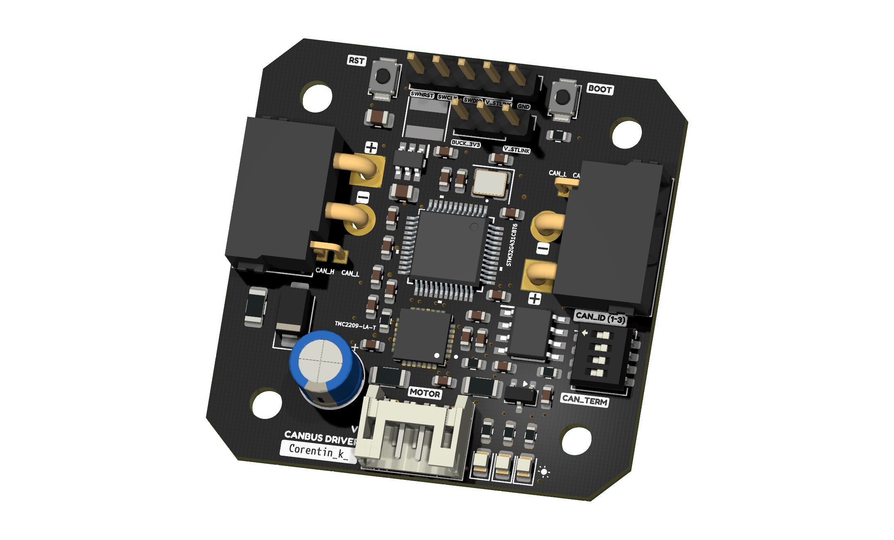
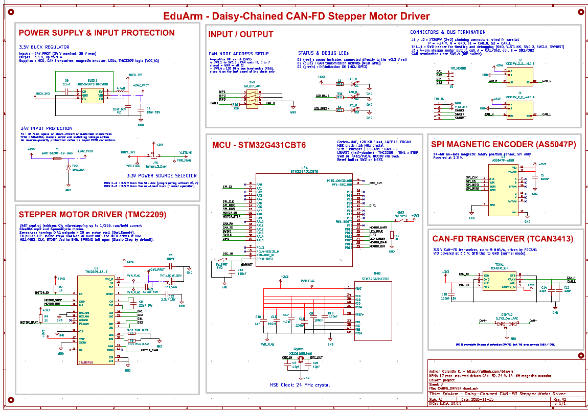
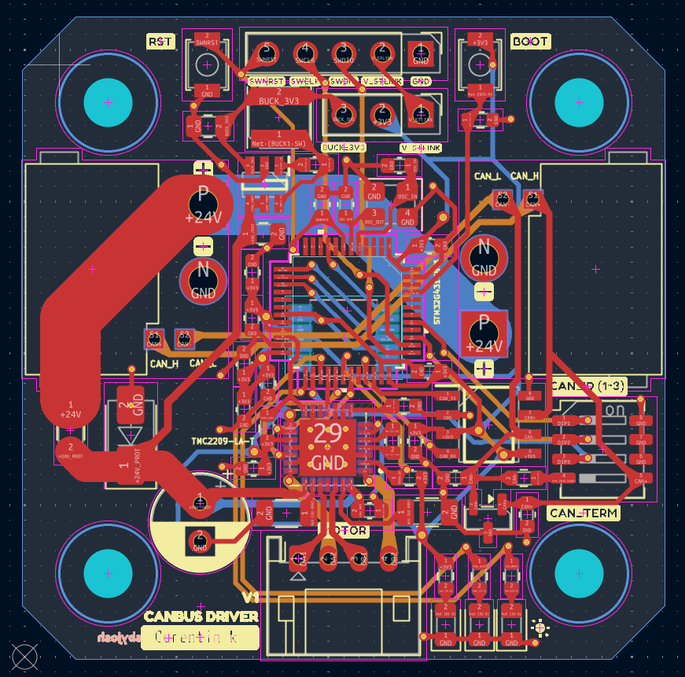
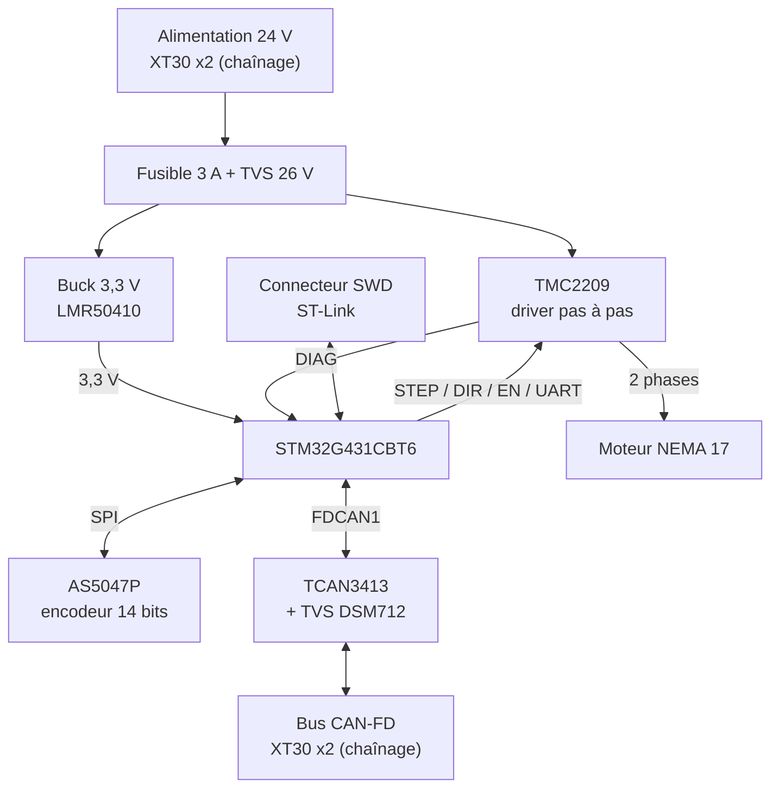

# EduArm – Daisy-Chained CAN-FD Stepper Motor Driver

Carte driver pour moteur pas à pas **NEMA 17**, pilotée en **CAN-FD** et **chaînable** (daisy-chain). Elle se fixe directement au dos du moteur et embarque un **encodeur magnétique 14 bits** pour connaître la position de l'arbre.



Conçue pour le projet **EduArm** (bras robotique éducatif).


| | |
|---|---|
| **Auteur** | Corentin_k_ |
| **Date** | 15/11/2026 |
| **Version** | V1  |
| **Outil** | KiCad 10.0.8 |


---

## Sommaire

1. [Structure du dépôt](#structure-du-dépôt)
2. [Fonctionnalités](#fonctionnalités)
3. [Aperçu](#aperçu)
4. [Architecture](#architecture)
5. [Caractéristiques](#caractéristiques)
6. [Composants principaux](#composants-principaux)
7. [Protections d'entrée](#protections-dentrée)
8. [Connecteurs et interface](#connecteurs-et-interface)
9. [Brochage du microcontrôleur](#brochage-du-microcontrôleur)

---
## Structure du dépôt

```
.
├── README.md
├── CANFD_DRIVER.kicad_pro
├── CANFD_DRIVER.kicad_sch
├── CANFD_DRIVER.kicad_pcb
├── lib/                  # symboles et empreintes et modèle 3D
└── docs/
    ├── CANFD_DRIVER_sch.pdf
    ├── CANFD_DRIVER_pcb.pdf
    └── img/
```

---

## Fonctionnalités

- Pilotage d'un moteur pas à pas NEMA 17 par un **TMC2209** : microstepping jusqu'à 1/256, courant réglable par UART, modes **StealthChop2** (silencieux) et **SpreadCycle**.
- **Détection de blocage sans capteur** (StallGuard4) : la broche `DIAG` passe à l'état haut au calage du moteur.
- Bus **CAN-FD** (jusqu'à 5 Mbit/s) avec **deux connecteurs XT30** qui transportent l'alimentation 24 V et le bus : les cartes se chaînent les unes aux autres.
- **Adresse CAN** réglable par un commutateur DIP (8 adresses) et **terminaison 120 Ω** activable.
- **Encodeur magnétique AS5047P** (14 bits, SPI) placé dans l'axe du moteur.
- Alimentation 24 V protégée (fusible + TVS), régulateur **3,3 V** intégré.
- Programmation et débogage par **SWD** (ST-Link), boutons `BOOT` et `RST`, 3 LED d'état.

## Aperçu

### Schématique



[Schématique complète (PDF)](./docs/CANFD_DRIVER_SCH.pdf)

### PCB



[(PDF)](docs/CANFD_DRIVER_PCB.pdf)

### Rendu 3D


---

## Architecture



---

## Caractéristiques

| Paramètre | Valeur |
|---|---|
| Tension d'alimentation | **24 V DC** nominal (limite du TMC2209 : 4,75 à 29 V) |
| Courant moteur | Réglable par UART, jusqu'à **1,77 A RMS** (limite matérielle : sense 2 × 0,11 Ω). **NEMA 17 jusqu'à 1,5 A** |
| Microstepping | Jusqu'à 1/256 |
| Bus de communication | CAN-FD, 5 Mbit/s maximum |
| Adresses CAN | 8 (DIP 3 bits) |
| Capteur de position | AS5047P, 14 bits (16 384 positions par tour) |
| Microcontrôleur | STM32G431CBT6 (Cortex-M4F, 128 Ko Flash, LQFP48) |
| Horloge | Quartz 16 MHz (HSE) |
| PCB | 4 couches, 1,6 mm, **42,3 × 42,3 mm**, entraxe de fixation **31 mm** (NEMA 17) |
| Règles de conception | Piste / espace min. 0,25 / 0,20 mm, perçage min. 0,3 mm |

---

## Composants principaux

> Prix indicatifs relevés sur LCSC (novembre 2026), susceptibles de varier.

### Microcontrôleur

**STM32G431CBT6** – Cortex-M4F avec FDCAN, LQFP48.
[LCSC C529355](https://www.lcsc.com/product-detail/C529355.html) – 4,43 € l'unité

**Quartz X322516MLB4SI** – 16 MHz, 9 pF, boîtier 3225, pour l'horloge HSE.
[LCSC C13738](https://www.lcsc.com/product-detail/C13738.html) – 0,45 € les 5

### Driver de moteur pas à pas

**TMC2209-LA-T** (Trinamic / Analog Devices)
[LCSC C2150710](https://www.lcsc.com/product-detail/C2150710.html) – 2,57 € l'unité

| | |
|---|---|
| Tension moteur | 4,75 à 29 V |
| Courant de sortie | jusqu'à 2 A RMS |
| Interfaces | STEP / DIR et UART (adresse 0) |
| Microstepping | 1/8 à 1/64 par broches, jusqu'à 1/256 par UART |
| Modes | StealthChop2 (silencieux), SpreadCycle (couple élevé), StallGuard4 (détection de blocage) |
| Mise en veille | Broche `EN` tirée à 3,3 V par une résistance : **moteur désactivé au démarrage** |

### Alimentation 3,3 V

**LMR50410Y3FQDBVRQ1** – régulateur buck synchrone 3,3 V fixe, 2,1 MHz.
[LCSC C5219374](https://www.lcsc.com/product-detail/C5219374.html) – 1,46 € l'unité

| | |
|---|---|
| Entrée | 4 à 36 V |
| Sortie | 3,3 V, 1 A (alimente MCU, CAN, encodeur) |

La source du 3,3 V se choisit avec le jumper à souder `JP1` : position 1-2 pour alimenter la carte par le ST-Link, position 2-3 pour l'alimenter par le buck.

### Encodeur magnétique

**AS5047P-ATSM** – capteur de position angulaire 14 bits, sortie SPI.
[LCSC C962063](https://www.lcsc.com/product-detail/C962063.html) – 4,81 € l'unité

| | |
|---|---|
| Résolution | 14 bits |
| Alimentation | 3,3 V, environ 15 mA |
| Interface | SPI (mode 1) |

### Transceiver CAN-FD

**TCAN3413DR** – transceiver CAN-FD 3,3 V.
[LCSC C22433320](https://www.lcsc.com/product-detail/C22433320.html) – 1 € l'unité

| | |
|---|---|
| Débit | jusqu'à 5 Mbit/s |
| Courant d'alimentation | environ 42 mA |
| Entrées logiques | TXD / RXD à 3,3 V (FDCAN1 du STM32) |
| Sorties bus | CANH / CANL |

**DSM712** (réseau TVS double) – protection ESD des lignes CANH / CANL.
[LCSC C502564](https://www.lcsc.com/product-detail/C502564.html) – 1,27 € les 20

### Interface utilisateur

| Fonction | Référence | LCSC | Prix |
|---|---|---|---|
| DIP 4 positions | 3 bits d'adresse CAN + 1 terminaison | [C54769760](https://www.lcsc.com/product-detail/C54769760.html) | 0,54 € l'unité |
| LED rouge | Présence du 3,3 V | [C965812](https://www.lcsc.com/product-detail/C965812.html) | 0,66 € les 100 |
| LED verte | Initialisation réussie | [C965815](https://www.lcsc.com/product-detail/C965815.html) | 0,62 € les 100 |
| LED bleue | Transmission CAN en cours | [C965817](https://www.lcsc.com/product-detail/C965817.html) | 0,72 € les 100 |
| Boutons | `BOOT` et `RST` | [C720477](https://www.lcsc.com/product-detail/C720477.html) | 0,48 € les 10 |

---

## Protections d'entrée

L'alimentation 24 V traverse deux protections avant d'atteindre le driver et le régulateur.

| Composant | Référence | Rôle |
|---|---|---|
| **Fusible F1** | SART S1206-SD-3.0A, 3 A temporisé, 63 V DC, pouvoir de coupure 50 A. [LCSC C845163](https://www.lcsc.com/product-detail/C845163.html) – 0,35 € les 5 | Coupe le circuit en cas de court-circuit ou de surintensité prolongée (driver en défaut, par exemple).   |
| **TVS1** | SMAJ26A, tension de service 26 V. [LCSC C908774](https://www.lcsc.com/product-detail/C908774.html) – 0,54 € les 20 | Absorbe les surtensions transitoires (pics de régénération du moteur, commutations). Protège le TMC2209 (maximum absolu 32 V) et le buck. |

> **Pas de protection contre l'inversion de polarité** : les connecteurs XT30 sont détrompés. Bien faire attention au cablage avant le premier branchement !

---

## Connecteurs et interface

### Alimentation et bus CAN (J1, J2)

Deux connecteurs **XT30PW (2+2)** montés en parallèle pour le chaînage. Chacun transporte l'alimentation 24 V (broches P et N) et le bus CAN (broches de signal S1 et S2).
[C19268030](https://www.lcsc.com/product-detail/C19268030.html) + [C19268028](https://www.lcsc.com/product-detail/C19268028.html) – 0,57 € + 0,35 € l'unité

| Broche | Signal |
|---|---|
| P | +24 V |
| N | GND |
| S1 | CAN_H |
| S2 | CAN_L |

### Sortie moteur (J5)

Connecteur 4 broches. [C160349](https://www.lcsc.com/product-detail/C160349.html), [C160356](https://www.lcsc.com/product-detail/C160356.html), [C157898](https://www.lcsc.com/product-detail/C157898.html) – 2,43 € les 100 + 1,09 € les 5 + 0,45 € les 10

| Broche | Signal | Bobine |
|:---:|---|---|
| 1 | OA1 | A |
| 2 | OA2 | A |
| 3 | OB1 | B |
| 4 | OB2 | B |

### Programmation (SWD)

| Broche | Signal |
|:---:|---|
| 1 | GND |
| 2 | V_STLINK |
| 3 | SWDIO |
| 4 | SWCLK |
| 5 | SWNRST |

### Commutateur DIP

| Interrupteur | Fonction |
|:---:|---|
| 1 à 3 | Adresse CAN (0 à 7) |
| 4 | Terminaison CAN 120 Ω (à fermer sur la dernière carte du bus) |

---

## Brochage du microcontrôleur

| Broche | Signal | Fonction |
|:---:|---|---|
| PA8 | `MOTOR_EN` | Activation du driver (actif à l'état bas) |
| PA9 | `MOTOR_STEP` | Impulsions de pas (TIM1) |
| PB15 | `MOTOR_DIR` | Sens de rotation |
| PB10 | `MOTOR_UART` | UART du TMC2209 (USART3, mode half-duplex) |
| PB14 | `MOTOR_DIAG` | Sortie StallGuard / erreur du driver |
| PA5 / PA6 / PA7 | `SPI_CLK` / `SPI_MISO` / `SPI_MOSI` | SPI1 vers l'encodeur |
| PA1 | `SPI_CS` | Chip select de l'encodeur |
| PA11 / PA12 | `CAN_RX` / `CAN_TX` | FDCAN1 |
| PB4 / PA15 / PB12 | `DIP1` / `DIP2` / `DIP3` | Adresse CAN |
| PB11 | `LED_BLUE` | Transmission CAN |
| PB13 | `LED_GREEN` | Initialisation |
| PA13 / PA14 | `SWDIO` / `SWCLK` | Débogage |
| PB8 | `BOOT0` | Bouton `BOOT` |
| PG10 | `NRST` | Bouton `RST` |

---

*Corentin K. – Projet EduArm – 2026*
